# スライドのパターン（定義案）

状態: 定義案（2026-11-17）。2026-11-18 に本人の決定（「これで作ってみて」）を受けて、デザインシステムのページ（`design-system/README.md` ほか、サイトは `/slides/design-system/`）に移した。**今の内容はそちらが正**。このファイルは当時の記録として残す。写真はその後に差し替えたので、下の写真のパスの多くはもう無い（今の写真は `shots/manifest.json`）。

- 写真の置き場所: `design-system/shots/<パターンのID>/<デッキ>-p<ページ番号>.png`。フォルダ名がパターンの ID
- ページ番号は `slides.md` の並び（クリックを含めない番号）。写真はクリックをすべて出した状態
- 構成の型の写真は、ページを左から右に並べた1枚の帯（`*-strip.png`）
- 写真は packages/slides の13デッキから取った。whats-cloud-assembly は `slides.md` がなく、写真にできなかった
- 言葉の出典は life の記録（`.claude/skills/slides/SKILL.md`、`tasks/speaking/diagram-style.md`、`tasks/speaking/` の各回の README、`docs/writing-style.md`）。かっこ内の日付はその記録の日付

デッキの略し方: container-31 = jawsug-container-31（コンテナ支部）、bgnr-93 = jawsug-bgnr-93（初心者支部で登壇したスライド）、continuum = cdk-custom-resource-continuum（茨城 #17）、cdkd-talk = jawsug-cdk-tokyo-cdkd-talk（CDK 支部×東京支部）、lt-40 = jawsug-tokyo-lunch-lt-40（ランチタイム LT #40）、ecr-sbom = ecr-sbom-supply-chain-investigation、failed-ecs = failed-ecs-log-cost-reduction、zero-drift = zero-drift-cdk-ops、cdk-day1 = cdk-day1-experiment、aws-oss = aws-oss-perspective、cdk-3min = cdk-3min-cooking

## パターンとは

本人のデッキで繰り返し使っている作り方に名前を付けて、次のデッキでも同じ形で使えるようにしたもの。中身（何を言うか）は毎回本人が決めるので、パターンは形だけを決める。

パターンは4つの層に分ける。

- **土台**: 全ページに共通する決まり（色、書体、文の書き方、図のスタイル）
- **部品**: ページの中に置く1つの要素
- **ページの型**: 1枚の組み方
- **構成の型**: ページの並べ方（話の流れ）

---

## 土台

### base-color 色

- **何の型か**: 文字は濃い紺、強調は赤の太字、表紙と最後のページは青のグラデーション。表紙のキーワードだけ黄色
- **いつ使うか**: 全ページ。色は意味で使い、同じ意味には同じ色（diagram-style.md）
- **写真**: `shots/base-color/container-31-p01.png`、`shots/base-color/container-31-p12.png`

### base-text 文の書き方（写真なし）

- **何の型か**: 見出しは名詞句。見出しとリード文は「だ・である」調、紙芝居と字幕は話し言葉（初心者支部、2026-10-29）。主語を抜かない。英語と日本語の間に空白を入れない。例示は「e.g.」。「CFn」と略さない。文字は1行に収める。表と絵文字は使わない
- **いつ使うか**: 全ページ
- **写真**: なし（決まりだけ）

### base-diagram 図のスタイル

- **何の型か**: 手で組んだ SVG。流れは左から右。角丸の薄い塗りのグループ枠と白い箱、AWS のアイコン、主語のある短いラベルの矢印（diagram-style.md。本人「かなり自分の好み」）
- **いつ使うか**: 仕組みや流れを見せるとき。「文より図」（5つの目線の4）
- **写真**: `shots/base-diagram/container-31-p05.png`、`shots/base-diagram/container-31-p11.png`、`shots/base-diagram/lt-40-p09.png`

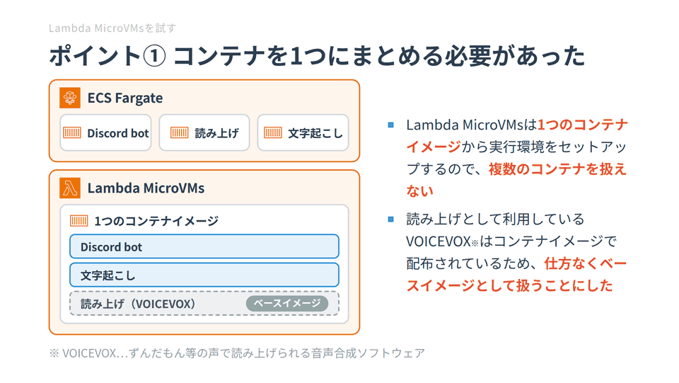

---

## 部品

### part-icon-heading アイコン付きの見出し

- **何の型か**: サービスのアイコン＋見出し
- **いつ使うか**: サービスや機能を説明するページ（コンテナ支部のスライドを茨城 #17 にそろえた、2026-11-16）
- **写真**: `shots/part-icon-heading/container-31-p12.png`、`shots/part-icon-heading/container-31-p10.png`

### part-arrow-conclusion 「→」の1行

- **何の型か**: ページの下に「→」から始まる1行を置き、そのページで言いたいことを結ぶ
- **いつ使うか**: 説明や図のあとに結論を言うとき。説明しきれなかった所を書く場所にもなる（初心者支部「ページ下の『→』から始まる状況説明も使ってよい」2026-10-28、「各特徴はまず説明を一文で書く。紹介しきれなかった部分は図、もしくは一番下の行に『→』」2026-10-29）
- **写真**: `shots/part-arrow-conclusion/container-31-p11.png`、`shots/part-arrow-conclusion/bgnr-93-p10.png`

### part-strong 強調（赤の太字）

- **何の型か**: 言いたいキーワードだけを赤の太字にする
- **いつ使うか**: タイトル・「〜とは？」の定義・言い切りのキーワード。多用しない（茨城 #17「そこ強調する！？と感じるところが多かった」2026-09-27）。表紙で強調するのは1か所（初心者支部、2026-10-28）
- **写真**: `shots/part-strong/container-31-p03.png`、`shots/part-strong/bgnr-93-p23.png`

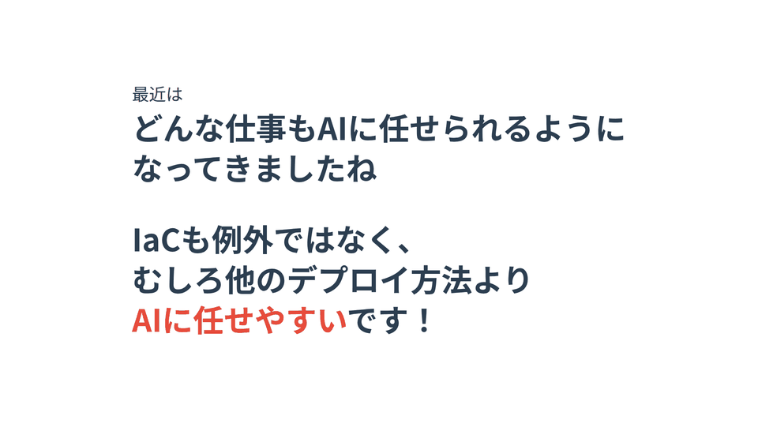

### part-underline 色分けした下線

- **何の型か**: 言葉に色の違う下線を引き、対応を見せる
- **いつ使うか**: 2つ以上のものの対応を見せるとき。赤文字を減らす代わりに使う（LT #40）。初心者支部では「不要」（2026-10-29）だったので、使うかは回ごとに決めている
- **写真**: `shots/part-underline/jiyugaoka-any-1-p05.png`、`shots/part-underline/lt-40-p07.png`

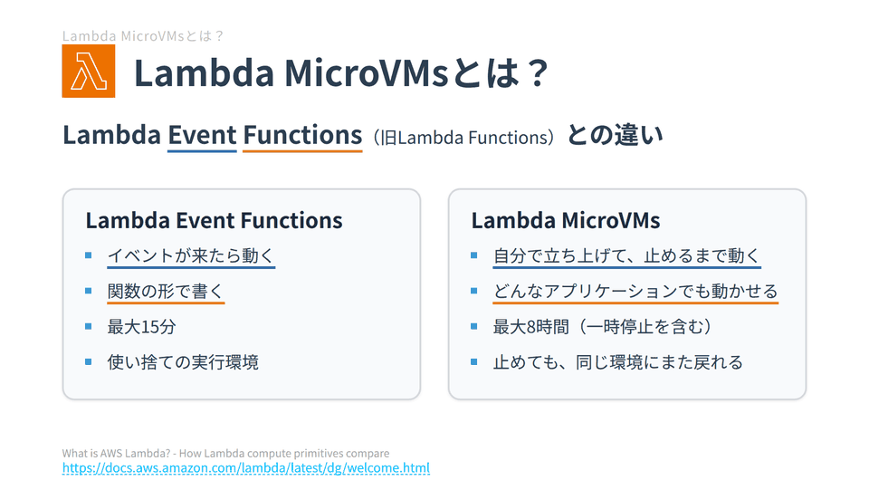

### part-kogoe 小声（Kogoe）

- **何の型か**: 小さく薄い文字。言い切りの前置きや補足をささやくように置く
- **いつ使うか**: 「それでは…」「まとめ」の前置き、「〜というお悩みを解決します」、箇条書きの補足（茨城 #17「リストアップ型（Markdown の箇条書き＋Kogoe の補足）」）
- **写真**: `shots/part-kogoe/continuum-p12.png`、`shots/part-kogoe/cdk-day1-p12.png`

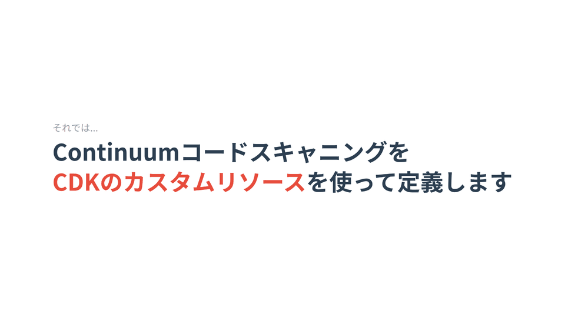
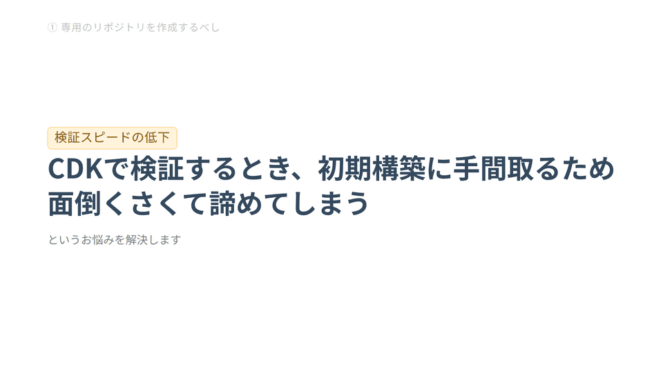

### part-overlay Overlay

- **何の型か**: ページの上に灰色の帯で短い一言を重ねる
- **いつ使うか**: そのページのまとめか、次のページに進むための一言。長い箇条書きは載せない（茨城 #17「Overlay はそのページで書いた内容のまとめや、次のページに進むための簡潔な一言を示す補助の場所」2026-09-28）
- **写真**: `shots/part-overlay/container-31-p06.png`、`shots/part-overlay/cdkd-talk-p10.png`、`shots/part-overlay/cdk-day1-p13.png`、`shots/part-overlay/failed-ecs-p04.png`

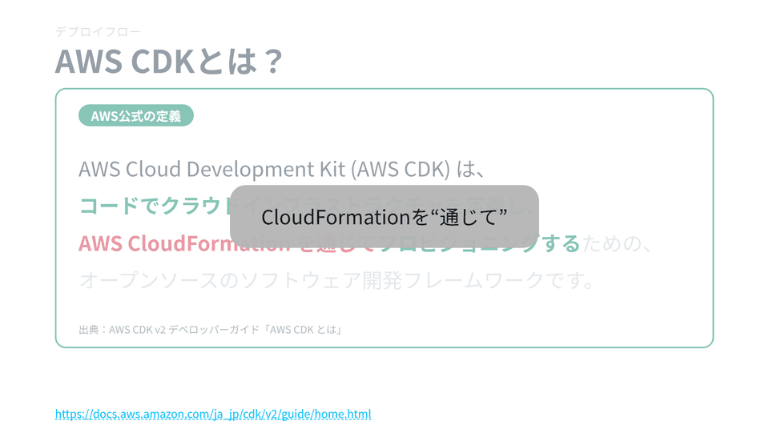
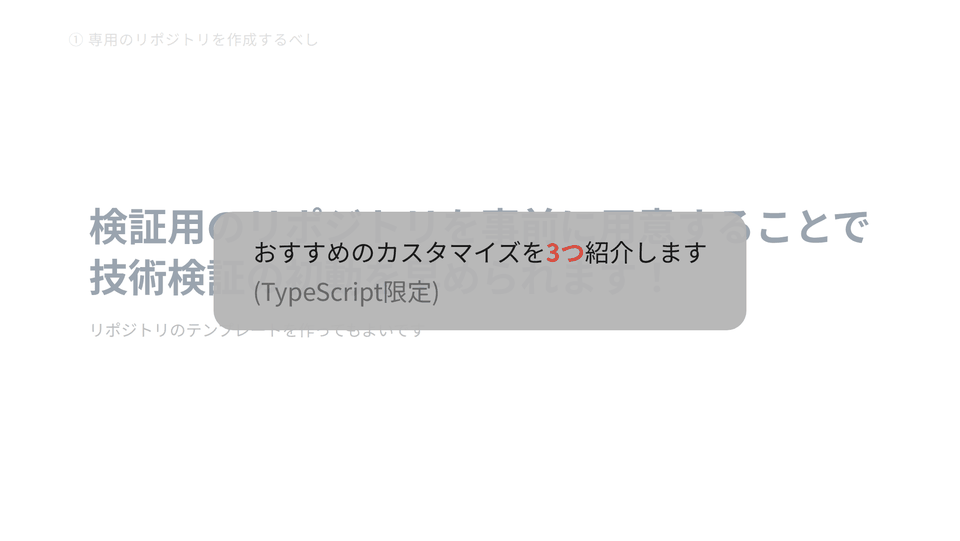
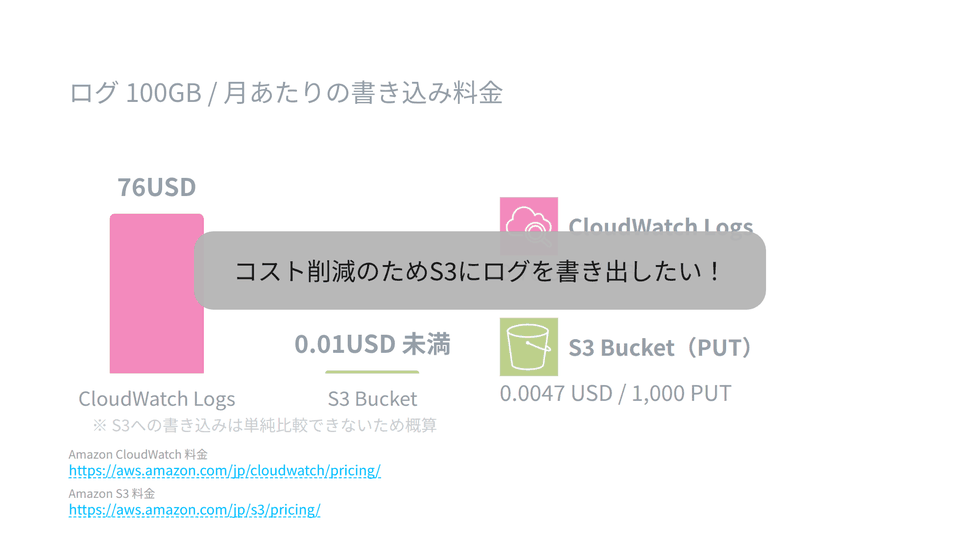

### part-bottomlink 出典のリンク（BottomLink）

- **何の型か**: 左下に小さく出典の題名とリンク
- **いつ使うか**: 公式ドキュメントの定義や数字を引いたページ
- **写真**: `shots/part-bottomlink/container-31-p09.png`

### part-chapterlabel 章ラベル（ChapterLabel）

- **何の型か**: 左上に薄く小さく、いまの章の名前
- **いつ使うか**: 章の多いデッキで、いまどこの話かを示すとき。初心者支部では「デッキ全体で不要」（2026-10-29）だったので、使うかはデッキごとに決めている
- **写真**: `shots/part-chapterlabel/lt-40-p09.png`、`shots/part-chapterlabel/cdkd-talk-p17.png`

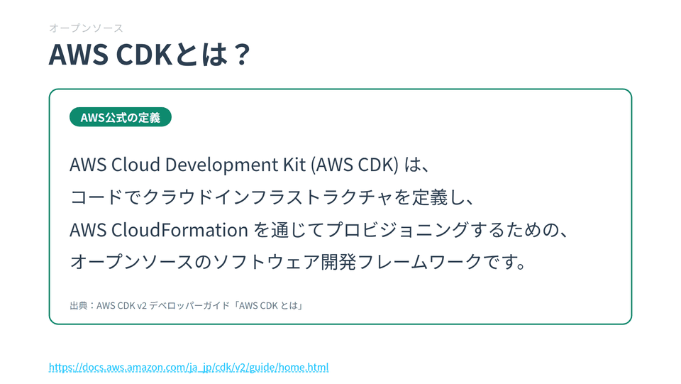

### part-subtitle-band 字幕帯

- **何の型か**: 映画の字幕のように、一番下の帯に話し言葉を出す
- **いつ使うか**: ストーリー型のページだけ。話し言葉は字幕帯以外に書かない（初心者支部、2026-10-29）
- **写真**: `shots/part-subtitle-band/bgnr-93-p06.png`

### part-tag タグ（Tag）

- **何の型か**: 色付きの小さな札。お悩みの種類などを見出しの上に添える
- **いつ使うか**: cdk-day1 のお悩みのページで使っている。ほかのデッキでは見当たらないので、残すかは確認したい
- **写真**: `shots/part-tag/cdk-day1-p12.png`

### part-kari 仮の札（写真なし）

- **何の型か**: 本人が決めていない所の右上に「仮：〜は未定」の札
- **いつ使うか**: 作っている途中だけ。発表版には残らないので写真はない（SKILL.md）

---

## ページの型

### page-title 表紙

- **何の型か**: 青のグラデーションに、イベント名（小）・タイトル・日付と名前、右下にアイキャッチ
- **いつ使うか**: 1枚目。強調はキーワード1か所（初心者支部「表紙で強調するのは『IaC入門』のみ」2026-10-28）
- **写真**: `shots/page-title/container-31-p01.png`、`shots/page-title/bgnr-93-p01.png`、`shots/page-title/ecr-sbom-p01.png`

### page-profile 自己紹介

- **何の型か**: 左に写真、右に名前と所属・推しサービス
- **いつ使うか**: 2枚目。中身は聞く人に合わせる（自由が丘.any は AWS ではなく趣味、2026-11-09）
- **写真**: `shots/page-profile/container-31-p02.png`

### page-kamishibai 紙芝居型

- **何の型か**: 小さい前置き＋大きい言い切り（SKILL.md「紙芝居のページ（`layout: center` の前置き＋言い切り）」）。話し言葉で書く（2026-10-19 本人「紙芝居は基本口語で書いてない？」）
- **いつ使うか**: 導入（LT #40「紙芝居形式なのは導入だけ」2026-10-18）。初心者支部では2部の冒頭にも使い、クリックで2つ目の言い切りを出した（2026-10-29）
- **写真**: `shots/page-kamishibai/jaws-sonic-2026-p04.png`、`shots/page-kamishibai/bgnr-93-p23.png`、`shots/page-kamishibai/zero-drift-p21.png`、`shots/page-kamishibai/jiyugaoka-any-1-p04.png`

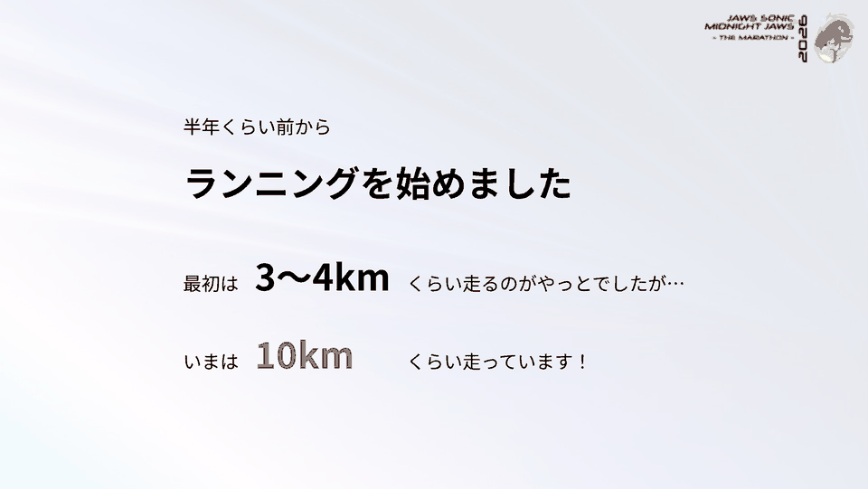

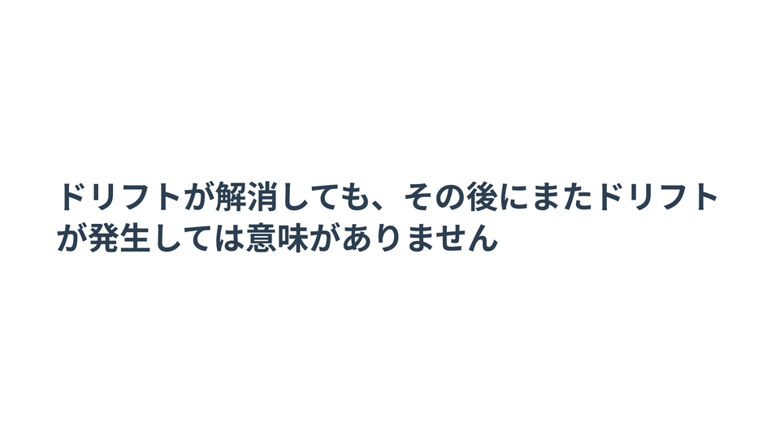

### page-statement 言い切り（問いかけ・話の宣言）

- **何の型か**: 前置きなしで、真ん中に大きく1文。問いかけ（「みなさんは〜できていますか？」）、困りごと（「〜が高い！！！」）、話の宣言（「〜の話をします」）
- **いつ使うか**: 導入で話のきっかけを出すとき。紙芝居型の仲間か、別の型かは確認したい
- **写真**: `shots/page-statement/container-31-p03.png`、`shots/page-statement/continuum-p04.png`、`shots/page-statement/failed-ecs-p03.png`、`shots/page-statement/zero-drift-p03.png`、`shots/page-statement/cdk-3min-p04.png`

### page-chapter 章扉

- **何の型か**: 章の名前だけを大きく置く1枚。紙芝居の形で「それでは／〜について解説していきます」と書くこともある（初心者支部、左寄せ、2026-10-29）
- **いつ使うか**: 章や部の始まり。特徴を並べる前のつなぎは Overlay ではなく章扉（初心者支部、2026-10-28）。宣伝の前にも「宣伝」の章扉（茨城 #17）
- **写真**: `shots/page-chapter/bgnr-93-p11.png`、`shots/page-chapter/cdk-day1-p11.png`、`shots/page-chapter/zero-drift-p23.png`、`shots/page-chapter/ecr-sbom-p05.png`、`shots/page-chapter/jaws-sonic-2026-p08.png`

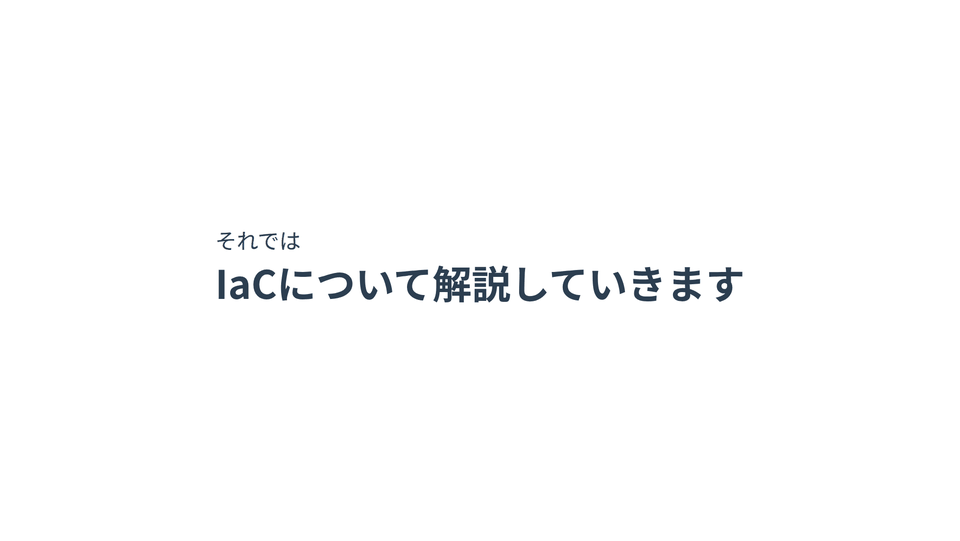
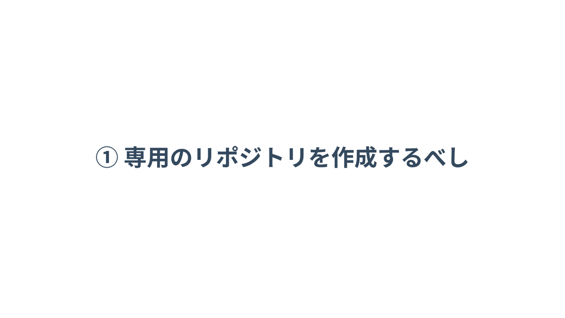
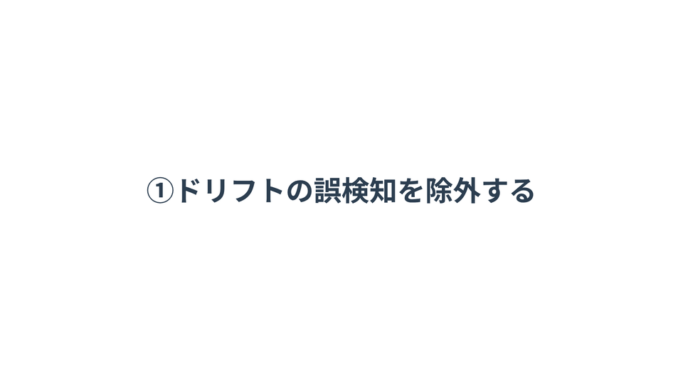

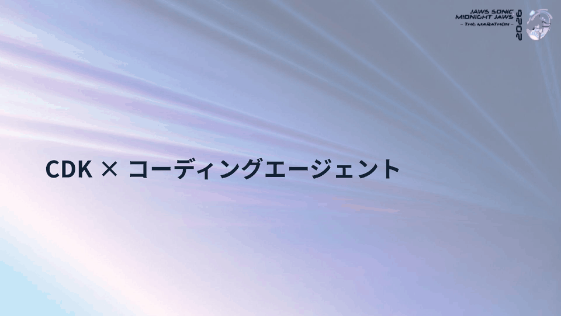

### page-story ストーリー型

- **何の型か**: 画面（図やスクショ）に、話し言葉の字幕帯を付けて物語を進める（初心者支部、2026-10-28。本人「ストーリー型のテンプレートとしてありかも」）。紙芝居型とは別のもの（本人「それはストーリー型、紙芝居型とは違うよ」）
- **いつ使うか**: 導入のストーリーだけ。章扉より後では使わない（初心者支部、2026-10-29）
- **写真**: `shots/page-story/bgnr-93-p05.png`、`shots/page-story/bgnr-93-p06.png`、`shots/page-story/bgnr-93-p07.png`

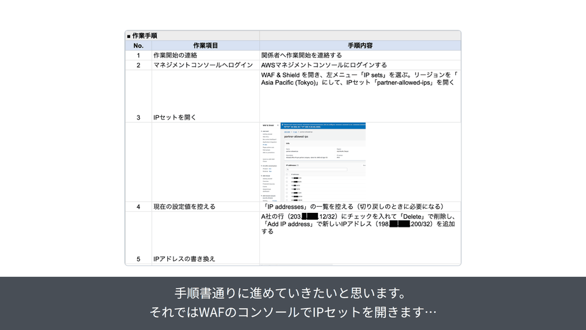
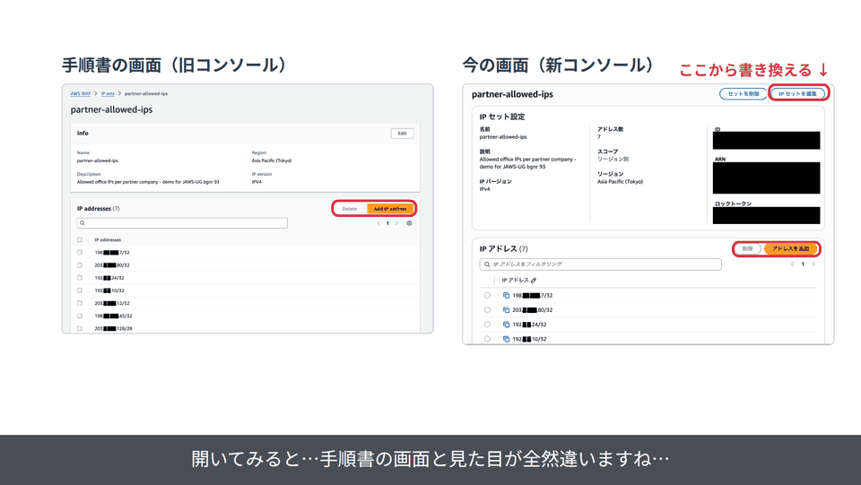
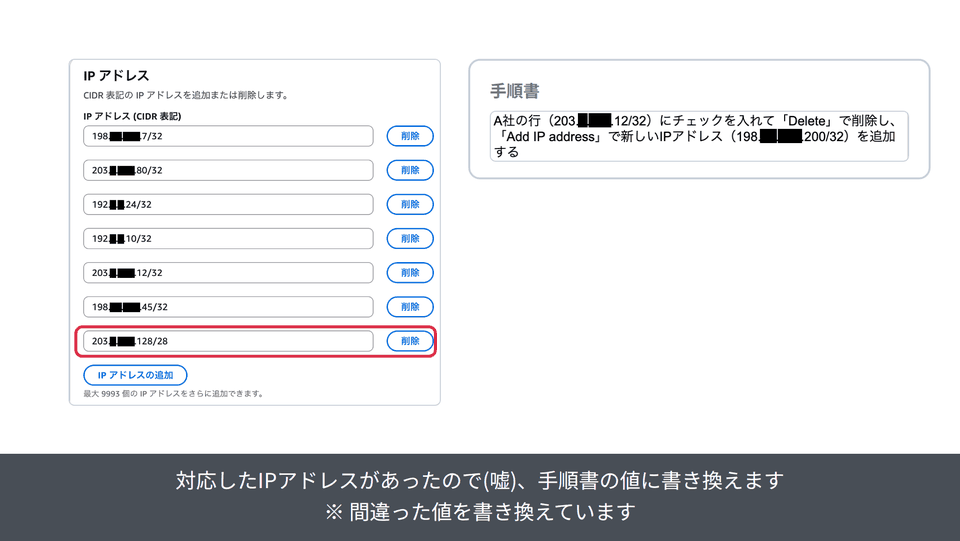

### page-what-is-list 「〜とは？」（リストアップ型）

- **何の型か**: アイコン付きの見出し「Xとは？」、定義のリード1文、その下に箇条書き（茨城 #17「リストアップ型（Markdown の箇条書き＋Kogoe の補足）」）
- **いつ使うか**: サービスや用語を初めて出すとき。役割を先に言い、解説はその直後に置く（コンテナ支部、2026-11-15）
- **写真**: `shots/page-what-is-list/container-31-p09.png`、`shots/page-what-is-list/ecr-sbom-p06.png`

### page-what-is-figure 「〜とは？」（図示型）

- **何の型か**: 見出し「Xとは？」、定義のリード1文、その下にアイコンと矢印で流れを描く（茨城 #17「図示型（アイコンと矢印で流れを描く。e.g. AWS CDKとは？）」）
- **いつ使うか**: 仕組みが流れで説明できるもの。アイコンを並べたカードで特徴を見せるのは本人の書き方ではない（2026-10-18）
- **写真**: `shots/page-what-is-figure/continuum-p03.png`、`shots/page-what-is-figure/zero-drift-p04.png`

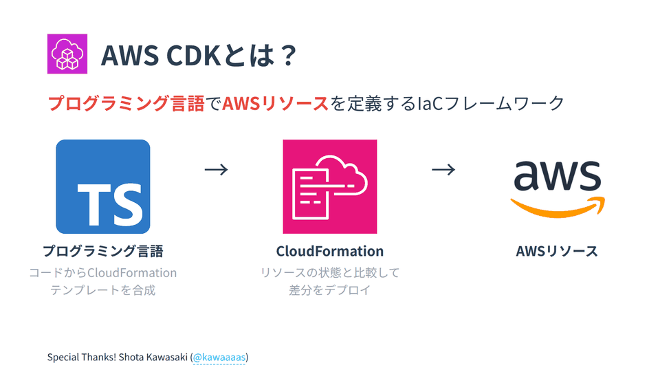
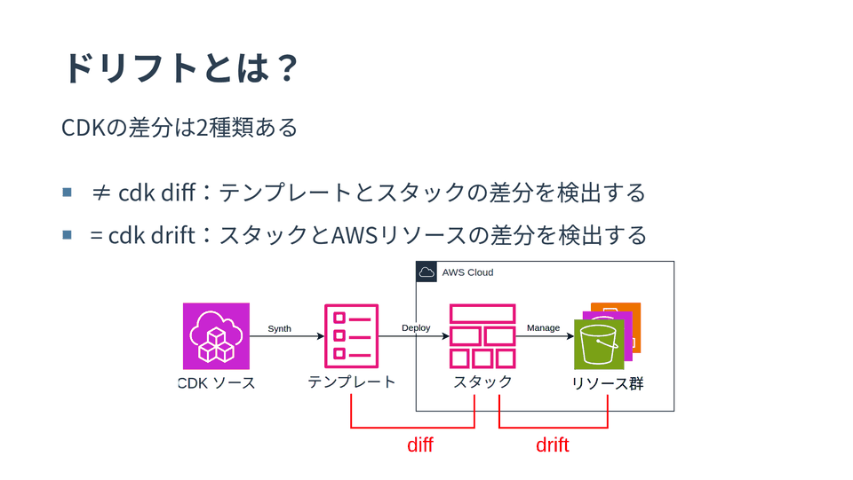

### page-definition-reuse 定義の使い回し

- **何の型か**: 同じ公式の定義のページを何度も出し、毎回その回の話に関わる部分だけをハイライト・ピックアップ・取り消し線などで強調する（SKILL.md）
- **いつ使うか**: 1つの定義を軸に話すとき。章の区切りで定義に戻る（本人「今回のスライドで新しく出てきたのは、CDKの定義を使いまわすところやな」）
- **写真**: `shots/page-definition-reuse/cdkd-talk-p03.png`、`shots/page-definition-reuse/cdkd-talk-p07.png`、`shots/page-definition-reuse/cdkd-talk-p12.png`、`shots/page-definition-reuse/cdkd-talk-p21.png`

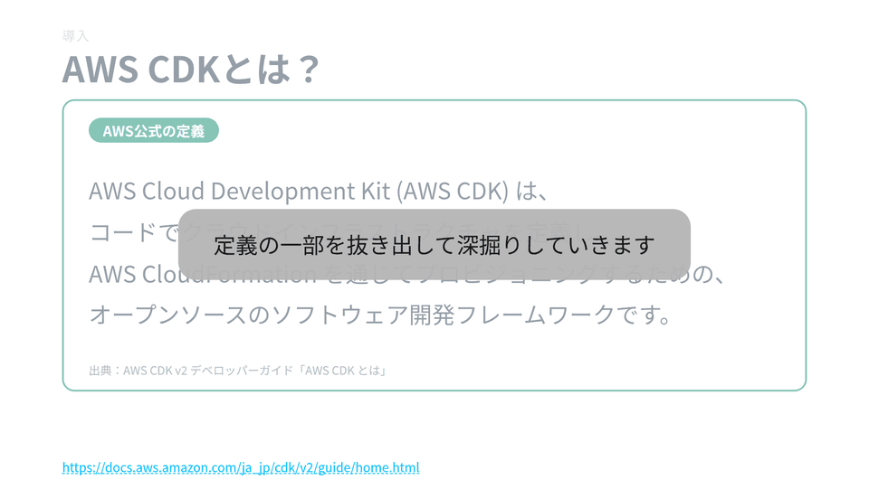
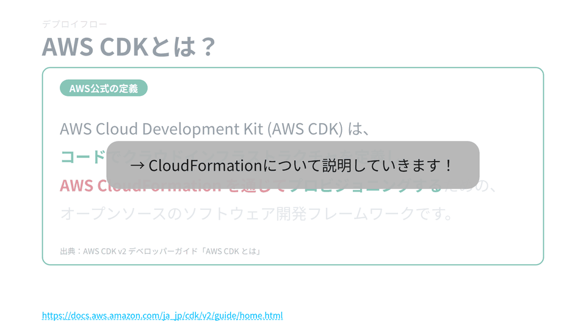
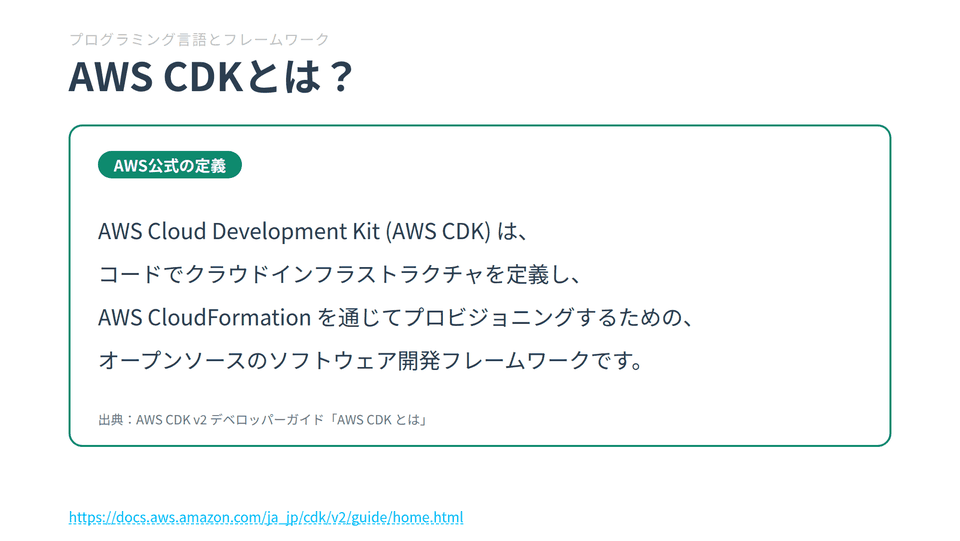
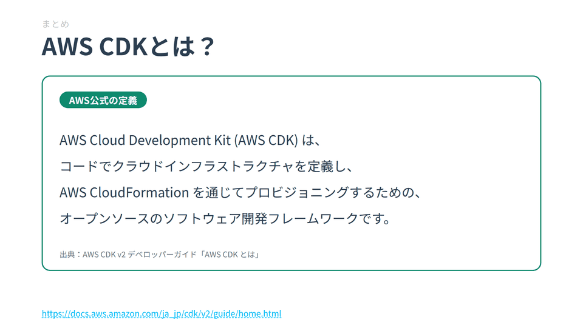

### page-one-by-one 特徴・理由を1つずつ

- **何の型か**: 小さい前置き（「IaCの特徴 ①」）＋短い名詞句の見出し＋主語のあるリード1文＋図1枚、必要なら「→」の1行。`view-transition` でつなぐ（SKILL.md。本人「めっちゃよくなった」）
- **いつ使うか**: 特徴や理由をいくつか順に見せるとき。題名だけを並べた一覧ページは作らない（LT #40「特徴のところで題名並べるだけなんてしたことない」、初心者支部 2026-10-29）
- **写真**: `shots/page-one-by-one/bgnr-93-p18.png`
- **注意**: この写真は図のアイコンが大きく崩れて写っている（下の「見つけた不具合」）。見出し・リード・図の配置だけを見てほしい

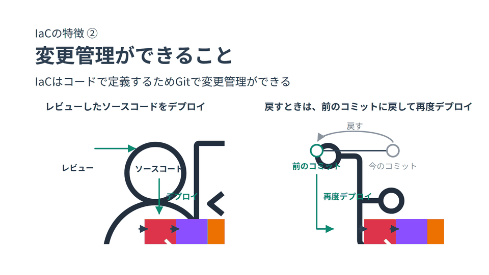

### page-list-conclusion 箇条書き＋結論

- **何の型か**: 見出し、左端に点が出る箇条書き（茨城 #17「リストは左端に点が出る書き方にする」）、補足は薄い小さい文字、最後に「→」の1行
- **いつ使うか**: 問題点や手段をいくつか並べて、1つの結論につなぐとき
- **写真**: `shots/page-list-conclusion/container-31-p08.png`、`shots/page-list-conclusion/bgnr-93-p10.png`、`shots/page-list-conclusion/continuum-p11.png`

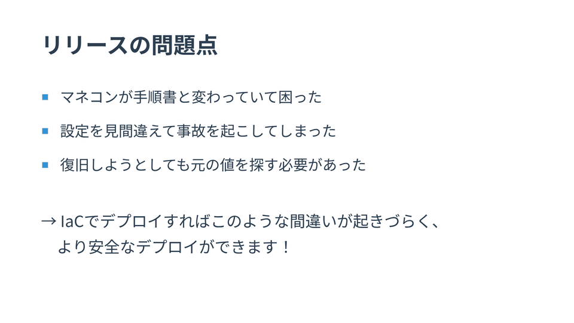
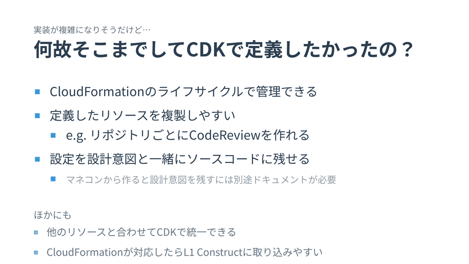

### page-figure-conclusion 図＋結論

- **何の型か**: アイコン付きの見出し、図1枚（またはグラフ）、下に「→」の1行
- **いつ使うか**: 構成や測った結果を見せて、そこから言えることを結ぶとき
- **写真**: `shots/page-figure-conclusion/container-31-p07.png`、`shots/page-figure-conclusion/container-31-p13.png`、`shots/page-figure-conclusion/container-31-p05.png`

### page-compare 2つを並べて比べる

- **何の型か**: 2枚のカードを左右に並べ、行ごとに対比する
- **いつ使うか**: 2つの方法やサービスの違い・使い分けを見せるとき（LT #40「Event Functions と MicroVMs の違い」、初心者支部のツール紹介は「LT #40 と同じ、2枚のカード」2026-10-28）。茨城 #17 の使い分けのページは発表後に「いちばん強い」とされた（2026-10-01）
- **写真**: `shots/page-compare/bgnr-93-p14.png`、`shots/page-compare/lt-40-p07.png`、`shots/page-compare/continuum-p20.png`

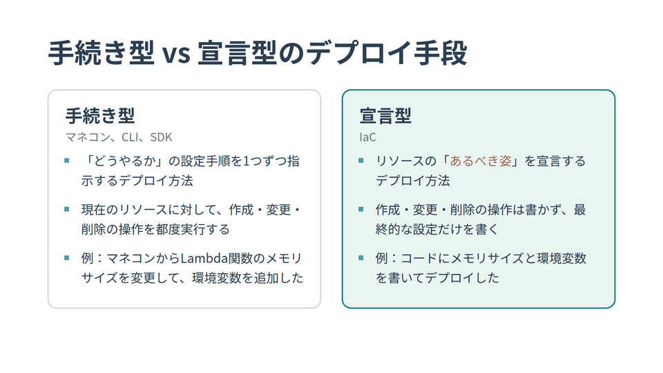

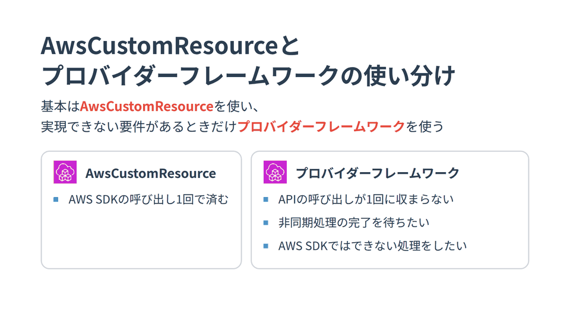

### page-onayami お悩み → 解決

- **何の型か**: 1枚目に聞く人のお悩みを大きく書き「というお悩みを解決します」と小声で添え、2枚目に解決策を言い切る
- **いつ使うか**: プラクティスや解決策を1つずつ紹介するとき（cdk-day1 の5つのプラクティス）。life に記録はなく、デッキから拾った型
- **写真**: `shots/page-onayami/cdk-day1-p12.png`、`shots/page-onayami/cdk-day1-p13.png`

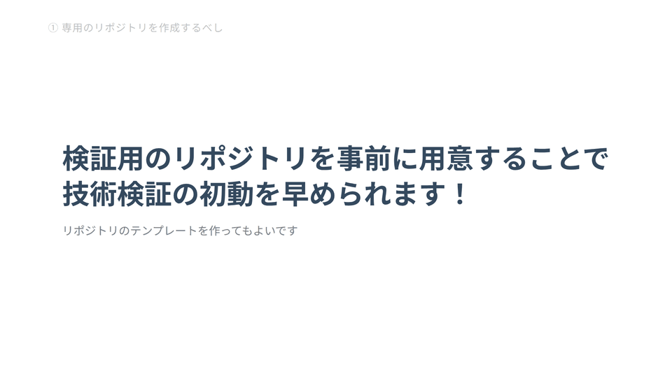

### page-qa Q&A

- **何の型か**: 「Q.」の問いと「A.」の答えを大きく並べる。A は赤
- **いつ使うか**: 聞く人が持ちそうな疑問に答えるとき。小さい文字を使わない（初心者支部「Qの前置きも同じ大きさ」2026-10-29）
- **写真**: `shots/page-qa/bgnr-93-p30.png`、`shots/page-qa/lt-40-p11.png`、`shots/page-qa/jaws-sonic-2026-p05.png`

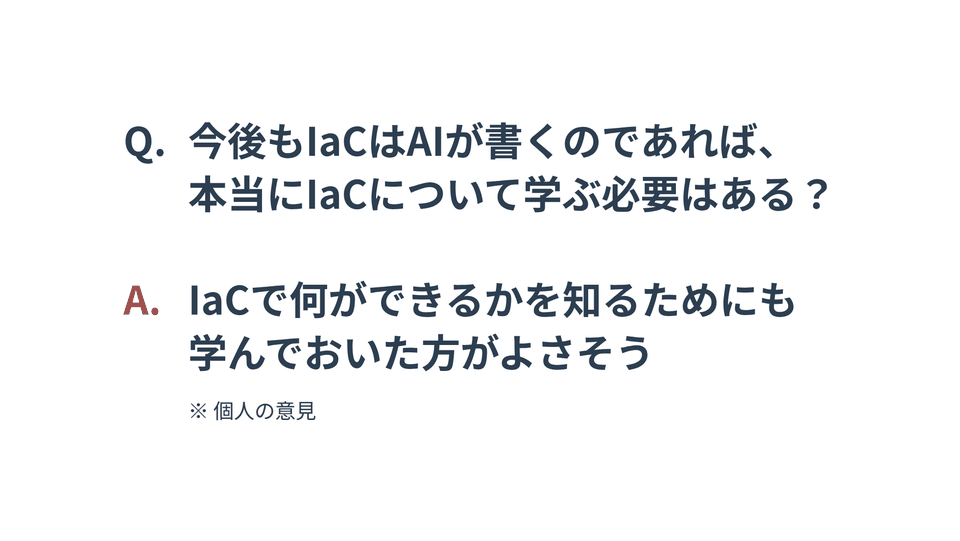
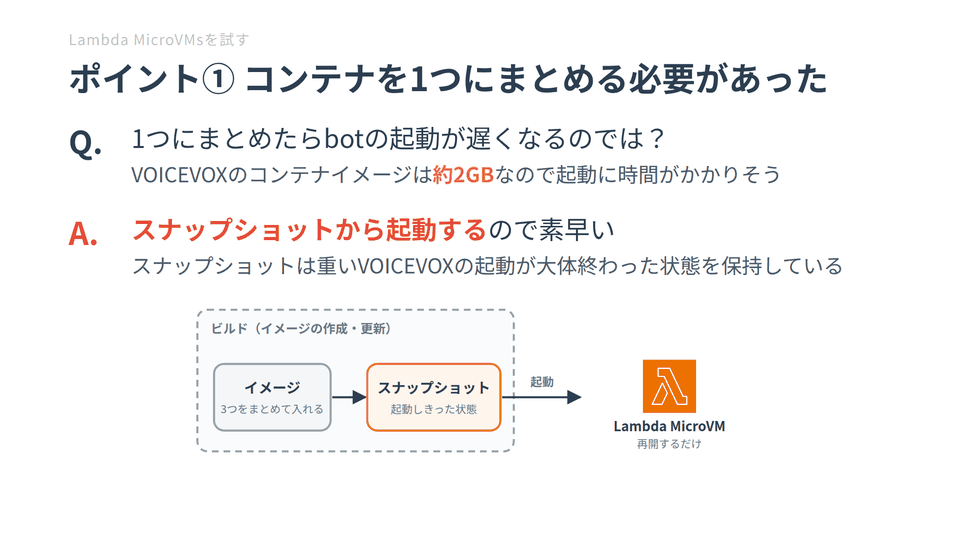
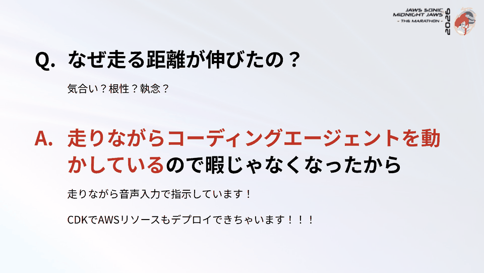

### page-summary-statement まとめ（言い切り）

- **何の型か**: 小さく「まとめ」、その下にこの資料で話したことを言い切る1文（コンテナ支部「本人の他のデッキのまとめと同じ型（例: SBOMの発表の『横断で検索する仕組みを作ると影響調査が爆速で終わる！！！』）」2026-11-15）
- **いつ使うか**: 話の芯が1つのデッキの締め
- **写真**: `shots/page-summary-statement/container-31-p14.png`、`shots/page-summary-statement/ecr-sbom-p13.png`、`shots/page-summary-statement/jaws-sonic-2026-p34.png`

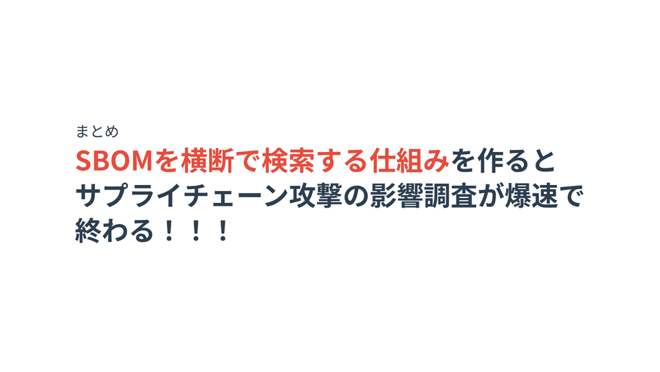
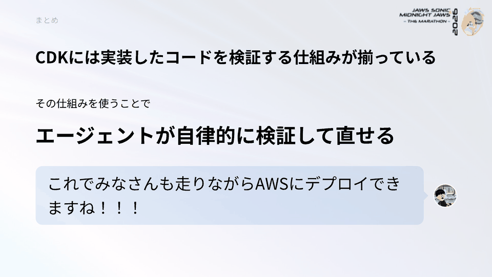

### page-summary-list まとめ（箇条書き）

- **何の型か**: 見出し「まとめ」と、話したことの箇条書き
- **いつ使うか**: 部がいくつかあるデッキの締め（初心者支部「締めのまとめは3部に対応する3行で出す」）。話したこと全体をまとめるだけにして、新しい宣言は足さない（自由が丘.any、2026-11-10）
- **写真**: `shots/page-summary-list/bgnr-93-p32.png`、`shots/page-summary-list/lt-40-p17.png`、`shots/page-summary-list/zero-drift-p37.png`、`shots/page-summary-list/failed-ecs-p13.png`

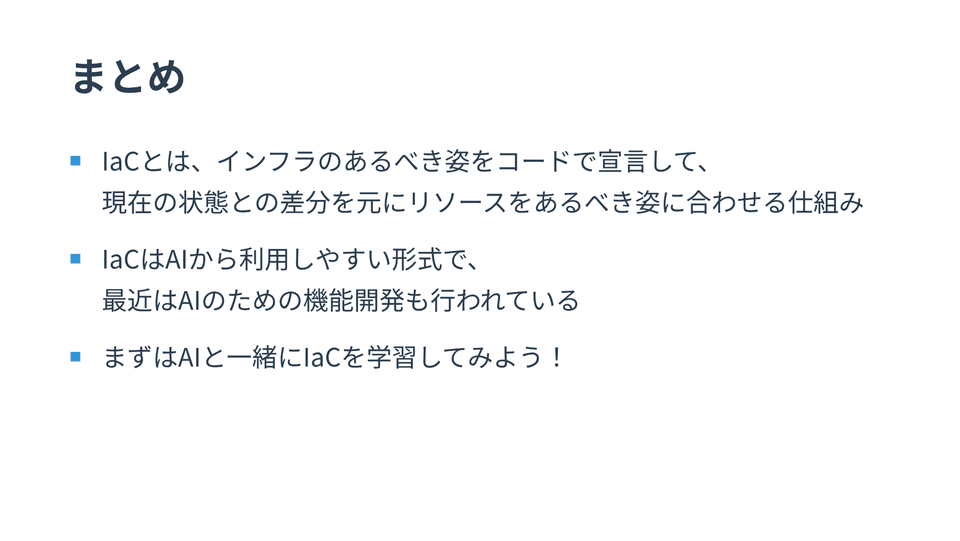
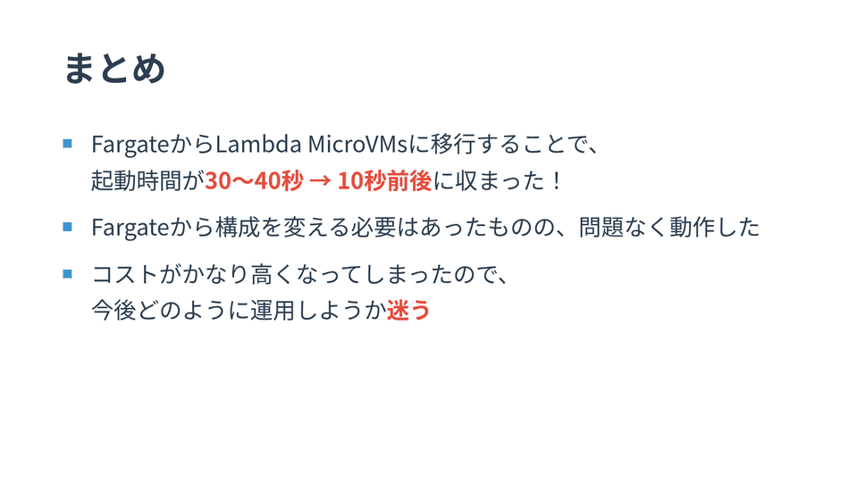
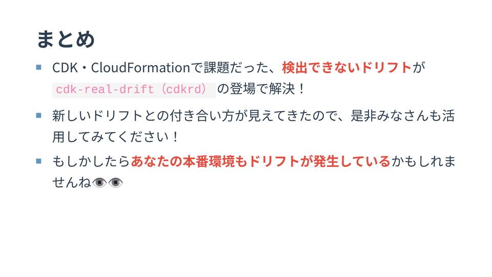
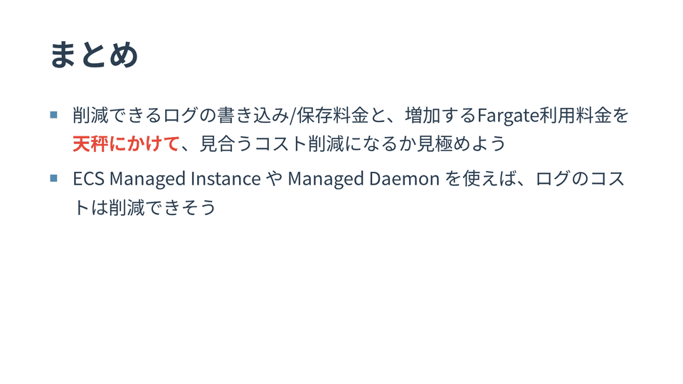

### page-promo 宣伝

- **何の型か**: 章扉「宣伝」のあとに、イベントや会社の告知
- **いつ使うか**: まとめと Thank You の間（茨城 #17 で「宣伝」の章扉を足した、2026-09-28）
- **写真**: `shots/page-promo/continuum-p22.png`、`shots/page-promo/aws-oss-p14.png`

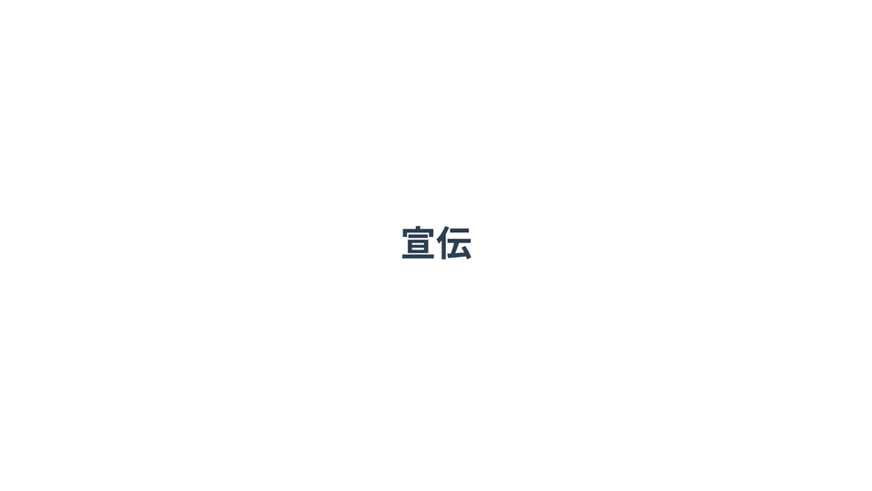
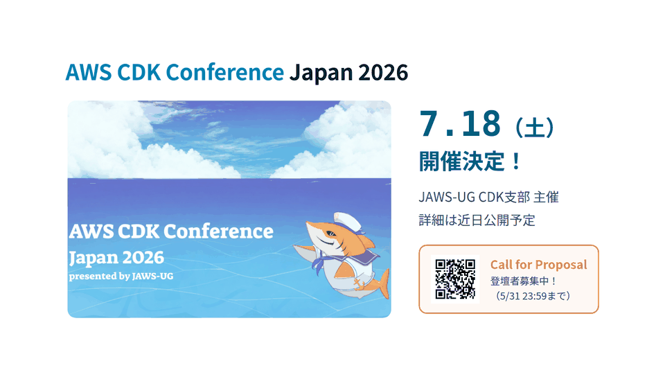

### page-thanks Thank You

- **何の型か**: 青のグラデーションに「Thank You!」と「＼ ご清聴ありがとうございました！ ／」、右下にアイキャッチ
- **いつ使うか**: 最後の1枚。それ以外は書かない（茨城 #17「いつもどおり」、aws-oss の形、2026-09-28）
- **写真**: `shots/page-thanks/container-31-p15.png`、`shots/page-thanks/aws-oss-p16.png`

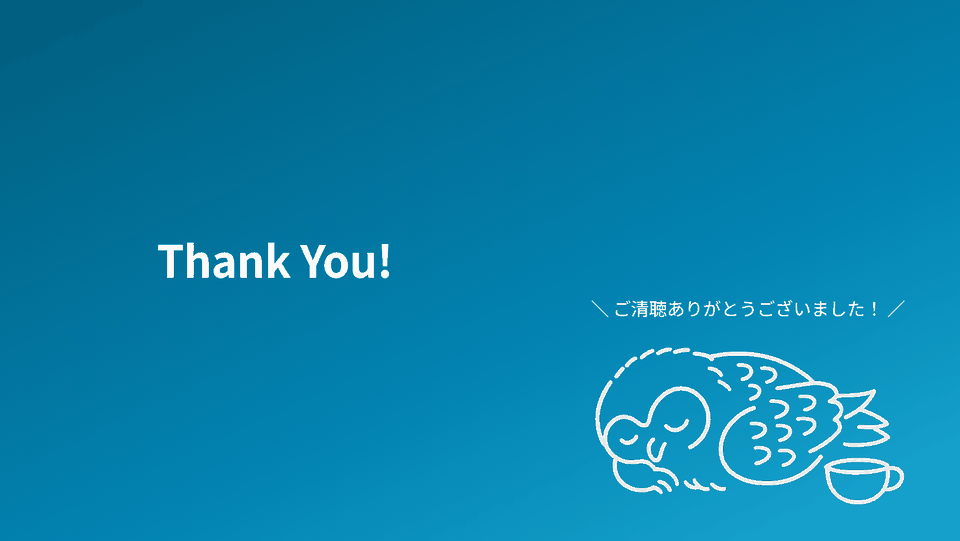

---

## 構成の型

### flow-whole 全体の骨組み

- **何の型か**: 表紙 → 自己紹介 → 導入 → 本編 → まとめ →（宣伝）→ Thank You
- **いつ使うか**: すべてのデッキ
- **写真**: `shots/flow-whole/container-31-strip.png`（コンテナ支部の p.1〜15 から10枚）

### flow-analyze-improve-review 分析 → 改善 → 振り返り

- **何の型か**: 各パートは「最初に時間がかかっているポイントを分析し、そのポイントを改善したらどうなったか？を振り返る」の繰り返し（コンテナ支部、2026-11-14 本人）
- **いつ使うか**: 何かを改善した話。改善の手段は役割を先に言い、解説はその直後に置く。最初の分析にあとで比べる項目を入れておき、振り返りでは同じ項目同士を並べる。悪くなった所も見せる（2026-11-15）
- **写真**: `shots/flow-analyze-improve-review/container-31-strip.png`（p.7 分析 → p.8 手段 → p.9・11 解説 → p.12 適用 → p.13 振り返り）

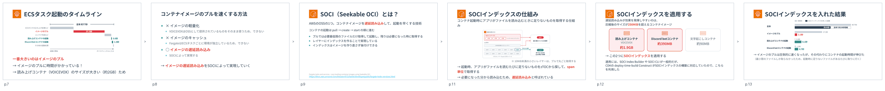

### flow-trouble-solution 困りごと → 解決策

- **何の型か**: 導入で困りごとを見せ、問題点を並べてから、解決策の話に入る（初心者支部、本人「こんなことに困ってない？？ってきいて解決策を出す方が刺さりそう」2026-10-24）
- **いつ使うか**: 入門や紹介の話で、聞く人に「自分のことだ」と思ってもらいたいとき
- **写真**: `shots/flow-trouble-solution/bgnr-93-strip.png`（p.5〜7 ストーリー → p.10 問題点 → p.11 章扉）

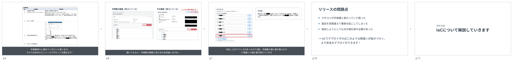

### flow-onayami お悩みを1つずつ解決

- **何の型か**: 章扉（「① 〜するべし」）→ お悩み → 解決、をプラクティスの数だけ繰り返す
- **いつ使うか**: いくつかのプラクティスを紹介する話（cdk-day1）。life に記録はなく、デッキから拾った型
- **写真**: `shots/flow-onayami/cdk-day1-strip.png`（p.11 → 12 → 13）

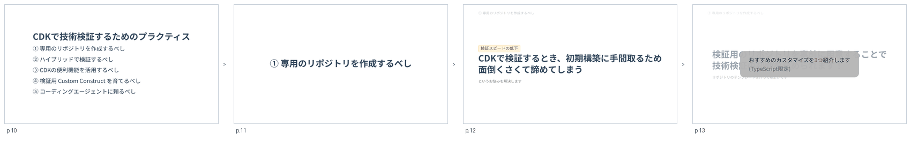

### flow-part-intro 部の頭に導入の紙芝居

- **何の型か**: 部を1段上に置き、各部の最初に章扉と紙芝居を入れる（LT #40、2026-10-19 本人と決定）
- **いつ使うか**: 部がいくつかあるデッキ
- **写真**: `shots/flow-part-intro/zero-drift-strip.png`（p.20 章扉 → 21 紙芝居 → 22 一覧 → 23 章扉）

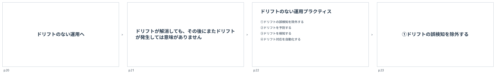

### flow-definition-return 定義に戻りながら進める

- **何の型か**: 「定義の使い回し」のページを章の区切りに置き、話を定義に戻しながら進める（CDK 支部×東京支部の発表、2026-11）
- **いつ使うか**: 1つの定義を深掘りする話
- **写真**: `shots/flow-definition-return/cdkd-talk-strip.png`（p.3 → 7 → 12 → 17 → 21）

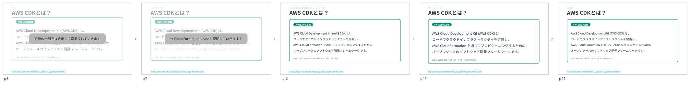

### flow-question-answer 疑問を湧かせてから解消する（写真なし）

- **何の型か**: 説明のあとに「何故そこまでして〜？」のページを置き、聞く人に湧いた疑問にすぐ答える（茨城 #17、2026-09-28）
- **写真**: 前後のページの図が崩れて写るため用意していない。疑問のページそのものは `shots/page-list-conclusion/continuum-p11.png`

---

## 本人に確かめたいこと

1. 写真を見て、好みでないパターンはどれか（外すか直す）
2. 紙芝居型の使いどころ: 「導入だけ」（LT #40）と、章扉・部の冒頭にも使う（初心者支部）のどちらを決まりにするか
3. 「言い切り」（page-statement）は紙芝居型に含めるか、別の型にするか
4. 章ラベルと色分けした下線は「デッキごとに選ぶ部品」としてよいか
5. デッキから拾っただけで life に記録のない型（お悩み → 解決、タグ）を入れるか
6. パターンの名前（ID と日本語名）はこれでよいか

## 見つけた不具合（今回は直していない）

`@slides/ui` の InlineSvg（`packages/ui/components/InlineSvg.vue`）の CSS が `.inline-svg :deep(svg)` になっていて、図の中に埋め込んだアイコンの `<svg>` にも `width: 100%` が当たる。そのため、`@slides/ui` の InlineSvg を使うデッキ（bgnr-93、continuum、cdkd-talk など）では、AWS のアイコンが図いっぱいに大きく描かれる。書き出しでも、単独のページでも同じだった。container-31 はデッキの中に持っている InlineSvg（`.inline-svg > :deep(svg)`）を使っていて、崩れない。`>` を足せば直るはずだが、公開済みのデッキの見た目が変わるので本人の確認を待つ。
